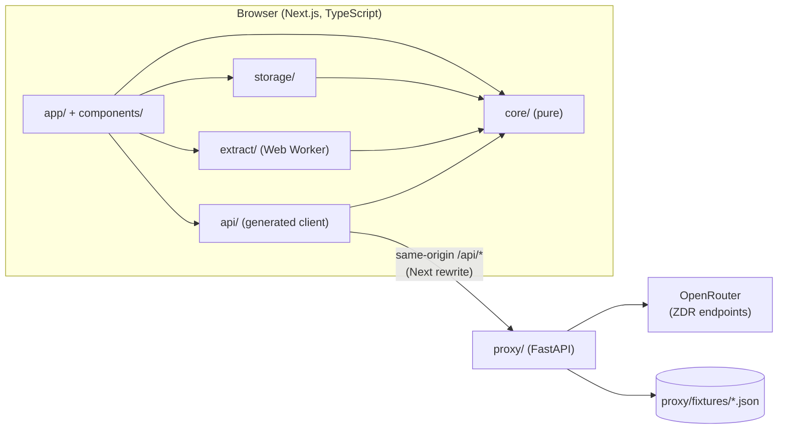
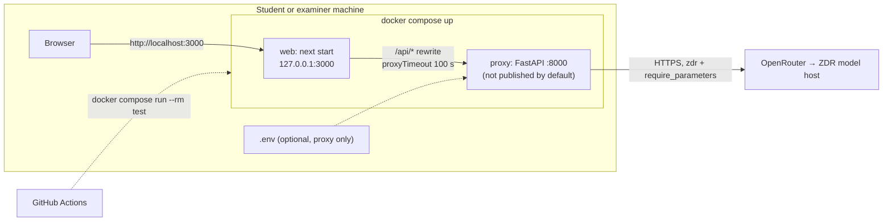
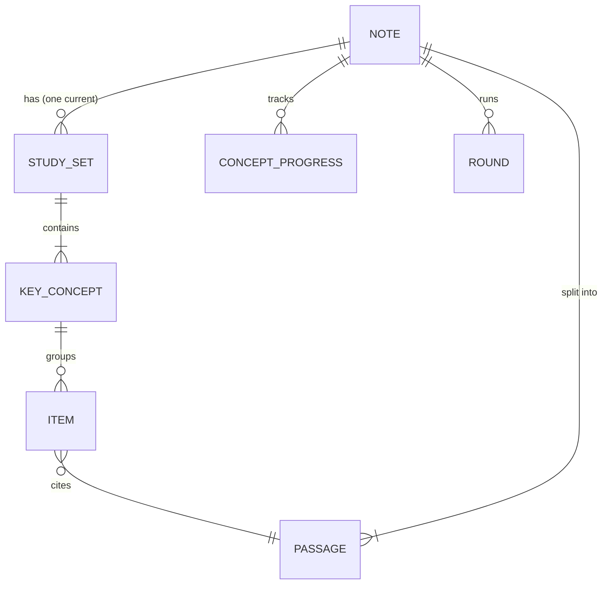

# Architecture Spine: Torsas læringsassistent v1

## Design Paradigm

**Functional core, imperative shell** in the browser, plus a **thin gateway** (the Proxy) in front of the AI provider.

- **Core** (`web/core/`): pure TypeScript functions with no React, no I/O and no implicit clock or randomness (both are passed in as arguments). It holds Normalization, Passage splitting, Note Hash, IDs, `verifyStudySet` (Quote Check and floors), the send gate, Mastery, Round composition, scoring and Readiness.
- **Shell** (`web/app/`, `web/components/`, `web/extract/`, `web/storage/`, `web/api/`): React screens, the extraction Web Worker, the single storage module and the generated API client. The shell calls the core and performs the side effects.
- **Gateway** (`proxy/`): FastAPI. Holds the key, the prompts and the Fixtures, calls the model, and validates structure and counts. It stores no Note data and writes nothing to disk; its only state is the in-memory rate-limit counter. It never normalizes or compares Note text.



Arrows are the only allowed dependency directions. `core/` imports nothing outside itself. Only `storage/` touches browser storage, and only `api/` calls the network.

## Invariants & Rules

### AD-1: Stack shape: Next.js frontend + FastAPI Proxy [ADOPTED]

- **Binds:** all
- **Prevents:** re-deciding the stack per epic; pulling in server-side parts of the Pytagoras reference that v1 has no use for.
- **Rule:** The browser app is Next.js (TypeScript). The Proxy is FastAPI (Python) using pydantic-ai against OpenRouter. There is no database, cache server, auth, payments, email, reverse proxy or hosting. Caddy, Postgres, Redis, Supabase and Railway from `technology.md` are out.

### AD-2: One command starts everything: Docker Compose [ADOPTED]

- **Binds:** DR-1, DR-2, NFR-1, NFR-3, SM-4
- **Prevents:** per-OS start scripts, Node/Python version drift, and a start that fails on the examiner's machine without a key.
- **Rule:** `docker compose up` builds both images and starts `web` (`next start` on a production build) and `proxy`. The examiner needs only Docker. `compose.yaml` passes `env_file: [{path: .env, required: false}]` to `proxy` only. Every variable except `OPENROUTER_API_KEY` has a default in `compose.yaml`, and `web` gets no env file and no `NEXT_PUBLIC_*` variables. `proxy` has a healthcheck, and `web` waits until it is healthy. Profiles: default (`web`, `proxy`); `dev` bind-mounts the source, runs `next dev` and `uvicorn --reload`, and publishes the Proxy on `127.0.0.1:8000`; `test` adds the `test` service. Only `web` publishes a port by default, on `127.0.0.1:3000`.

### AD-3: Logic split between browser and Proxy [ADOPTED]

- **Binds:** FR-1–FR-10, FR-17–FR-19, FR-21
- **Prevents:** two Normalization implementations that silently disagree and drop Items; text logic leaking into Python.
- **Rule:** The browser owns extraction, Normalization, Passage splitting, Note Hash, all IDs, Quote Check, quiz-option uniqueness, all floors that apply after the Quote Check, Mastery, Round composition, scoring, Readiness and all persistence. The Proxy owns prompt templates and `PROMPT_VERSION`, the model call, Pydantic schema validation, the text-independent count rules (5–15 concepts, four options and an in-range correct index, the 40-word Summary Point limit, ≥5 Summary Points before the Quote Check, trimming to limits), the single retry, the Fixtures, and the key, origin, rate-limit and logging guards.

### AD-4: Pydantic is the single source of the contract [ADOPTED]

- **Binds:** every browser↔Proxy exchange
- **Prevents:** TypeScript and Python shapes drifting apart.
- **Rule:** Request and response shapes are Pydantic models in `proxy/app/schemas.py`, with camelCase JSON aliases. FastAPI publishes `/openapi.json`; `web/api/schema.d.ts` is generated from it with `openapi-typescript` and committed. No hand-written copy of a contract type exists in TypeScript. CI regenerates the file and fails on any diff. Browser-only types (AD-19, AD-21) are not contract types and live in `core/types.ts`.

### AD-5: Same-origin wiring through Next.js, guarded Proxy [ADOPTED]

- **Binds:** NFR-1, NFR-3, every API call
- **Prevents:** hard-coded Proxy URLs, CORS drift, rejected same-origin requests, and the test suite tripping the rate limit.
- **Rule:** The browser calls only relative `/api/*` paths. Next.js runs as a server (not static export) and rewrites `/api/*` to `http://proxy:8000` on the Compose network, with `experimental.proxyTimeout` set to 100 000 ms. The Proxy guard:
  - accepts a `POST` only when `Origin` is in `ALLOWED_ORIGINS` (`http://localhost:3000`, `http://127.0.0.1:3000`; the `dev` profile adds `http://127.0.0.1:8000`);
  - accepts a `GET` with no `Origin`, because browsers omit it on same-origin GETs;
  - rejects any other `Origin` with 403;
  - counts only `POST` requests with `mode: "live"` toward the limit (`RATE_LIMIT_PER_MIN`, default 10; the `test` profile raises it). The 11th live request within a minute gets HTTP 429.

  There is no Next.js `proxy.ts` (request middleware) in v1. "Proxy" always means the FastAPI service.

### AD-6: Proxy API and error catalogue

- **Binds:** FR-4, FR-5, FR-6–FR-8, FR-11, FR-16, FR-23, FR-24
- **Prevents:** a second endpoint per feature, Demo and live taking different code paths, UI text in two runtimes, and unmapped failures reaching the student.
- **Rule:** There are three endpoints only:

  | Endpoint | Request | Response |
  | --- | --- | --- |
  | `GET /api/status` | — | `{keyConfigured, model, provider, promptVersion}` |
  | `POST /api/study-set` | `{mode: "live" \| "demo", noteHash, passages: [{id, text}]}` | `StudySet` |
  | `POST /api/simpler` | `{mode, noteHash, itemId, passage: {id, text}, item}` | `SimplerExplanation` |

  - `StudySet` nests Flashcards and Quiz Questions under their concept. Concepts carry names, never IDs. `StudySet` and `SimplerExplanation` carry `model`, `promptVersion` and `language`.
  - The browser calls `/api/status` at startup, retrying 3 times 1 s apart. Until it answers, live submit is disabled, the Consent text uses the fallback provider name from `messages.ts`, and Demo Mode and stored Notes stay usable.
  - Every error is an HTTP status plus `{code}`, where `code` is a Microcopy key:
    - `/api/study-set`: `err.noKey` (503), `err.demoOnly` (404), `err.generation` (502, 504, and 429 from the limiter). 400 and 403 are internal and shown as `err.generation`.
    - `/api/simpler`: every failure is shown as `simpler.fail` with the Item's own Quote.
  - The `api/` client maps a network error, an abort, a non-JSON body or an unknown code to `err.generation` (or `simpler.fail` for Simpler). A test asserts that every Proxy code is a key in `messages.ts`.

### AD-7: Validation, retry and time budget

- **Binds:** FR-7, FR-8, FR-9, FR-10, FR-11, FR-16, NFR-4, NFR-5
- **Prevents:** the browser and the Proxy both retrying, a Quote Check failure triggering regeneration, and a wait longer than the PRD allows.
- **Rule:** Only the Proxy retries, and only `/api/study-set`, exactly once. A retry happens when the output is invalid JSON, fails the schema, fails an AD-3 count rule, ends in a refusal or max-tokens stop, hits a provider 5xx or 429, or times out. After the second failure the Proxy returns `err.generation`. The time budget:
  - **Generation:** the browser aborts at 90 s (FR-11) and shows `err.generation`. The Proxy deadline is 85 s in total, with `GENERATION_TIMEOUT_S=40` per attempt; the retry runs only if at least 40 s remain.
  - **Simpler:** one attempt, no retry (NFR-5), `SIMPLER_TIMEOUT_S=15` (NFR-4).

  The browser never retries automatically; "Prøv igjen" is a user action that bypasses the cache. A failure found in the browser after the Proxy answered (AD-19) is never retried automatically and never cached. The timeout values live in `.env` and are re-set from the model comparison's timings, within these budgets.

### AD-8: Extracted Text is the only text

- **Binds:** FR-1–FR-4, FR-9, FR-12, FR-23, DR-3
- **Prevents:** the model, the source panel and the Quote Check seeing different text, so that valid Quotes fail or highlights land in the wrong place.
- **Rule:** One pipeline. Extraction lines → paragraph split (each table row and list item is its own paragraph) → per-paragraph Normalization (as in the PRD glossary, including hyphen rejoining, for every source) → sentence split over the Passage limit → Passages `p1…pn`. The Passages sent to the Proxy, shown in the source panel, checked by the Quote Check and stored with the Note are the same objects; they are persisted, never re-derived. Extraction runs in a Web Worker that is terminated after 15 s → `err.unreadable`. Per format:
  - `.md`/`.txt`: `File.arrayBuffer()` + `TextDecoder('utf-8', {fatal: true})`. On failure, `windows-1252` + `warn.encoding`. A BOM is stripped.
  - `.docx`: `mammoth.convertToHtml`, walked to lines with `htmlparser2` (workers have no `DOMParser`). One table row becomes one line, with cells joined by ` | `. Word equations (OMML) are lost in v1, which is documented in the README.
  - PDF: `unpdf` (`getDocumentProxy` + per-page text items). A line repeated at the top or bottom of at least half the pages, ignoring page numbers, is removed.

  Each Note records `normalizationVersion`, which is bumped by any change to extraction, Normalization or splitting. Such a change re-records the Fixtures in the same commit, and a test asserts that each reference note hashes to its Fixture's `noteHash`.

### AD-9: Identity and cache keys

- **Binds:** FR-4, FR-6, FR-12, FR-15, FR-17, FR-18, FR-21, FR-23
- **Prevents:** two modules deriving IDs or cache keys differently, so progress is lost or attached to the wrong concept or Item.
- **Rule:** These are defined once, in `core/`:
  - **Note Hash:** SHA-256 (Web Crypto), lowercase hex, of the normalized Passages joined by a blank line.
  - **Passage ID:** `p1`, `p2`, … in document order (the UI shows "P1").
  - **Key Concept ID:** `k-` + slug of the normalized name (lowercase, NFKC, Unicode letters and digits kept, every other run becomes `-`). If two concepts collide, the later one and its Items are dropped.
  - **Item ID:** `{keyConceptId}.fc{n}` or `{keyConceptId}.qq{n}`, and `sp{n}` for Summary Points. `n` is the 1-based order as returned by the Proxy, assigned before the Quote Check so IDs never shift when Items are dropped. Item IDs are valid only with their cache key.
  - **Cache key:** `{noteHash}:{promptVersion}:{model}`. It is written from the response (or Fixture) metadata, and on re-supply it is looked up with the values from `/api/status`. A mismatch regenerates.
  - **Demo Notes** are separate records keyed `demo:{noteHash}`, so Demo practice never touches live progress.

### AD-10: Storage: one module, two stores

- **Binds:** FR-4, FR-5, FR-15, FR-21, FR-22, FR-25–FR-27, NFR-8
- **Prevents:** epics inventing their own persistence or record shapes, a flash of the wrong theme or Consent screen, localStorage quota failures, and a schema change wiping everyone's data.
- **Rule:** `web/storage/` is the only code that touches `indexedDB` or `localStorage`.
  - **IndexedDB** (via `idb`) holds the records in AD-21.
  - **localStorage** holds settings: Consent, theme, `demoMode`, shortcuts, storage-warning shown, delete-warning / "Ikke spør igjen". With no stored theme, the theme follows `prefers-color-scheme`.

  Rules for both stores:
  - Every record is validated with Zod on read and on import.
  - Both stores carry a `schemaVersion`. Adding an optional field with a default never bumps it, and readers ignore unknown fields. A bump requires a tested migration in `storage/`.
  - Unreadable data is reset per Note (or the settings object alone) with `storage.reset`. If storage fails, the module falls back to memory for the session and reports `storage.unavailable`; Consent is then asked once per session.
  - Last write wins across tabs.
  - If the browser clears storage, the Consent gate appears again.

### AD-11: State mutation path

- **Binds:** FR-11, FR-13–FR-19, FR-21, FR-25–FR-27, NFR-8
- **Prevents:** components mutating Mastery or Round state in place or writing to storage on their own, duplicate requests, and late responses written into the wrong Note.
- **Rule:** A UI event calls a `core/` function that returns new state; the shell persists it through `storage/` and then renders from the result. There is no global state library: the open Note's state lives in one React context provider (`NoteSession`). `api/` is single-flight: at most one `/api/study-set` per Note Hash and one `/api/simpler` per Item ID are in flight, and a second call returns the pending promise. Every request carries an `AbortSignal`. Leaving the generating screen aborts the request, and a response for a Note that is no longer open is discarded, never written.

### AD-12: Demo Mode runs through the same path as live [ADOPTED]

- **Binds:** FR-23, FR-24, FR-16, DR-2, DR-3
- **Prevents:** a Demo Mode that passes while the live path is broken, and Fixtures drifting from the browser pipeline.
- **Rule:**
  - **Same endpoints:** Demo uses the same endpoints with `mode: "demo"`. The Proxy loads `proxy/fixtures/{noteHash}.json` and runs it through the same validation function as a live response.
    - An unknown hash returns `err.demoOnly`.
    - A missing Simpler entry fails like any Simpler request (`simpler.fail`).
  - **Fixture file:** `{studySet, simpler: {<itemId>: <raw>}, model, promptVersion}`, holding the raw model responses.
  - **Recording takes two steps:**
    1. `web/scripts/export-passages.ts` runs the real `extract/` + `core/` code on `reference-notes/` and writes `{noteHash, passages}`.
    2. `proxy/scripts/record_fixtures.py` reads that output and calls the live model through `llm.py`. No Python code splits or normalizes Note text.
  - **Sample notes:** the reference notes are copied into `web/public/samples/` at build time, with a manifest. Picking a sample runs the normal pipeline.
  - **Schema changes:** a pytest validates every Fixture against the current schema. A schema change re-records the Fixtures.
  - **Shared use:** the same files serve the automated tests and the exam-day fallback.

### AD-13: Model access through OpenRouter, Zero Data Retention only

- **Binds:** FR-5, FR-6–FR-8, FR-16, NFR-2, NFR-4, NFR-5, PRD Open Question 1
- **Prevents:** Note content reaching a provider that keeps or trains on it, routing to an endpoint that cannot return structured output, a model change silently reusing stale Study Sets, and Note text acting as instructions.
- **Rule:**
  - **Routing:** every live request goes to OpenRouter with provider routing `{zdr: true, data_collection: "deny", require_parameters: true}` and JSON-schema output (pydantic-ai `NativeOutput`). No `temperature` or `top_p` is sent.
  - **Model:** set by `OPENROUTER_MODEL`. The provisional start is `anthropic/claude-haiku-5.5`. The final pick, against `openai/gpt-6-luna` and `google/gemini-3.5-flash-lite`, is made by `web/scripts/evaluate.ts` on recorded responses for the reference notes, before prompt tuning. The comparison also measures NFR-4 timings.
  - **Prompts:** `PROMPT_VERSION` is bumped on every prompt change. Note text reaches the model only as JSON data inside the user message under a fixed delimiter, never in the system prompt. An injection test note sits in `reference-notes/edge-cases/`.
  - **Consent:** `/api/status.provider` is "OpenRouter", and the Consent text names OpenRouter and the model.
  - **Cost:** the expected cost is at most 2 calls per generation, about USD 0.002–0.006 per Note at November 2026 prices (≤ 0.012 with a retry). Explain Simpler costs about a tenth of that per call.
  - **Spend cap:** the key is created with an OpenRouter credit limit.

### AD-14: Proxy keeps nothing

- **Binds:** NFR-1, NFR-2
- **Prevents:** Note content or the key leaking through logs, error bodies, files or the browser; a Proxy that crashes without a key.
- **Rule:**
  - **Key:** exists only in the Proxy's environment. `.env` is git-ignored, and `.env.example` lists every variable without values. The OpenRouter provider is built lazily, so the Proxy starts and serves `/api/status` and Demo Mode with no key.
  - **Files:** the Proxy writes no files at runtime.
  - **Logging:** only method, path, status code, duration and error code, from the guard's own log line. Uvicorn's access log is off, the `httpx`, `openai` and `pydantic_ai` loggers are at `WARNING`, and no Logfire or OpenTelemetry is installed.
  - **Error handlers:** `RequestValidationError` and the generic exception handler are overridden to return `{code}` without echoing input.
  - **Test:** an automated test sends a marker string in a valid request, a malformed request and a provider error, and asserts that the marker appears in no log output and no file.

### AD-15: Styling: tokens + CSS Modules + Radix Primitives

- **Binds:** NFR-6, NFR-7, all UI
- **Prevents:** colour and spacing drift between epics; hand-rolled focus and keyboard handling that fails WCAG; a Consent gate that can be dismissed.
- **Rule:**
  - **Tokens:** `web/styles/tokens.css` holds every DESIGN.md token as a CSS custom property. `:root` is Lesesal and `[data-theme="dark"]` is Kveldsmodus. Components use `var(--token)` only, never hex values, and each component has one CSS Module.
  - **Radix:** Radix Primitives (unstyled) replace the native elements named in EXPERIENCE.md for Dialog, DropdownMenu ('Mer'), Tabs ('Studier') and Switch, and EXPERIENCE.md's behaviour rules still apply. They are styled via their `data-state` attributes. The Consent dialog blocks Esc and outside clicks. Everything else is native HTML.
  - **No Tailwind** and no styled component library.
  - **Rendering:** app content renders client-side only. An inline script in `app/layout.tsx` sets `data-theme` and `data-consent` on `<html>` before paint, and screens are client components behind a mount gate. While the dark-mode flag is off, the theme is always light.

### AD-16: Language and UI text

- **Binds:** NFR-9, NFR-6, FR-7, FR-16
- **Prevents:** UI strings scattered in components; screen readers reading an English Note with a Norwegian voice.
- **Rule:** `<html lang="nb">`. Every UI string comes from `web/i18n/messages.ts`, keyed by the EXPERIENCE.md Microcopy keys, and tests assert keys. `StudySet.language` (BCP-47, as reported by the model) is checked in `core/` against an allow-list with fallback `und`, and is set as `lang` on the element that wraps Note text and generated content. Simpler Explanations use the Study Set's language.

### AD-17: Should features behind flags

- **Binds:** FR-20, FR-22, FR-26, FR-27, dark mode, PRD §8
- **Prevents:** dead entry points after the 2026-12-01 cut, and ad-hoc toggles spread through the code.
- **Rule:** `web/features.ts` exports one boolean per Should feature. An entry point (button, menu item or settings row) renders only when its flag is `true`. The flag is turned on in the story that completes the feature and stays `false` if the feature is cut. The fields a Should feature stores exist in the schema from the start (AD-21).

### AD-18: One test command, same in CI

- **Binds:** DR-2, NFR-2, NFR-6, NFR-8, FR-3, FR-8, FR-9, FR-11, FR-14, FR-17–FR-19
- **Prevents:** tests that pass locally and fail in CI, or that need a key.
- **Rule:** `docker compose run --rm test` runs the whole suite with no key:
  - **Vitest:** `core/` and `extract/`, including the reference notes and `reference-notes/edge-cases/`.
  - **pytest:** the Proxy with the model stubbed. This includes the 90 s budget with a slow stub, booting with no key, the origin and rate-limit cases, and Fixture validation.
  - **Playwright** with `@axe-core/playwright`: the full Demo loop with a fresh browser context per test, plus double submit, double "Prøv igjen" and reload mid-generation.

  `@playwright/test` and the Playwright Docker image are pinned to the same version. GitHub Actions runs the same command, plus the contract-diff check from AD-4.

### AD-19: Verified Study Set: one browser shape

- **Binds:** FR-6, FR-7, FR-9, FR-10, FR-12, FR-19, FR-22
- **Prevents:** three incompatible stored shapes (raw contract, pruned contract, re-checked on every load), and floors with no owner after browser-side drops.
- **Rule:** `core/verifyStudySet(raw, passages)` does the following, in order:
  1. Assigns IDs (AD-9) and drops duplicate concepts.
  2. Runs the Quote Check and the quiz-option uniqueness check after Normalization.
  3. Applies the floors: fewer than 5 concepts or fewer than 5 Summary Points → `err.generation`; the FR-10 Item minimums → `err.tooFewItems`.
  4. Returns `{ok: false, code}` or `{ok: true, set: VerifiedStudySet}`.

  `VerifiedStudySet` is a browser type in `core/types.ts`. It keeps every concept, each with `covered: boolean` and only its surviving Items, plus `model`, `promptVersion`, `language` and `cacheKey`. Only this type is stored, rendered and exported; raw responses are never stored. Fixtures and imports go through the same function.

### AD-20: Send gate

- **Binds:** FR-5, FR-23, FR-24, FR-16, FR-11
- **Prevents:** the Consent, Demo and key checks being placed or ordered differently by each entry point (upload, "Prøv igjen", Simpler).
- **Rule:** `core/gate.ts` exports `canSend(settings, status, mode)` and checks in this order:
  1. `mode === "demo"` → ok.
  2. Consent not accepted → `consent.declined`.
  3. `!status.keyConfigured` → `err.noKey`.
  4. Otherwise → ok.

  The `api/` client calls it with fresh settings from `storage/` before every `POST`. No screen calls `fetch` or decides the gate itself.

### AD-21: Stored records

- **Binds:** FR-4, FR-15, FR-17, FR-18, FR-21, FR-22, FR-25–FR-27
- **Prevents:** two stories writing differently shaped or overlapping records for the same entity, lost updates, non-atomic progress writes and stale derived values.
- **Rule:** IndexedDB stores (every store has a `noteHash` index):

  | Store | Key | Holds |
  | --- | --- | --- |
  | `notes` | `noteHash` (or `demo:{noteHash}`) | `title` (file name without extension, or the first line of a paste, ≤ 80 chars; set at creation and never changed), `sourceType`, `wordCount`, `passages`, `normalizationVersion`, `currentCacheKey`, `archived`, `importanceLevel`, `lastPractisedAt` |
  | `studySets` | `cacheKey` | one `VerifiedStudySet` |
  | `conceptProgress` | `[noteHash, keyConceptId]` | `state`, `lastShownAt`, `lastUsedQuizQuestionId` (a missing row means *new*) |
  | `rounds` | `roundId` | `noteHash`, `cacheKey`, `itemIds`, `optionOrder`, `answers` (original option index), `status: active \| complete \| abandoned` |

  Transaction rules:
  - **Replacing a Study Set:** a Note has one current Study Set. Replacing it deletes the old set and prunes `conceptProgress` rows for vanished concept IDs, in one transaction.
  - **Starting a Round:** the Round is written when it starts, and the last-shown times are updated in the same transaction.
  - **Answering:** each mark or answer is one transaction with the resulting Mastery State.
  - **Interrupted Rounds:** an `active` Round is shown as incomplete on load and resumed, never recomposed. "Ny runde" sets it to `abandoned` and keeps its answers.
  - **Delete and archive:** both act on every record with that Note Hash, in one transaction.

  Readiness is never stored; it is computed by `core/` from these records. Opening a Note from 'Dine notater' or Arkiv uses its current Study Set and makes no Proxy call. Simpler Explanations are not persisted in v1.

  Export (FR-22) is `{format: "torsa-export", exportVersion: 1, note, studySet, conceptProgress}`. Import re-hashes the Passages, re-runs `verifyStudySet`, rejects any mismatch with `import.invalid`, and replaces that Note's records in one transaction.

## Consistency Conventions

| Concern | Convention |
| --- | --- |
| Naming | Glossary terms from the PRD in identifiers (`noteHash`, `keyConceptId`, `studySet`, `conceptProgress`, `round`). TS: camelCase values, PascalCase types and components. Python: snake_case, with camelCase JSON aliases. One component per folder: `Foo.tsx` + `Foo.module.css`. "Proxy" means only the FastAPI service. |
| Data and formats | Timestamps are ISO 8601 UTC strings. IDs as in AD-9. Errors are `{code}` with a message key. Every stored record carries `schemaVersion`. |
| Errors | Message keys end-to-end; no raw error text reaches the UI. Parsers, `storage/` and `api/` never throw to React; they return a result with a key. |
| Logging | Proxy: as AD-14. Browser: no Note content in `console` output. |
| Config | Proxy: `OPENROUTER_API_KEY`, `OPENROUTER_MODEL`, `GENERATION_TIMEOUT_S`, `SIMPLER_TIMEOUT_S`, `ALLOWED_ORIGINS`, `RATE_LIMIT_PER_MIN`. The browser has no secrets and no environment-specific URLs. |
| Accessibility | Every interactive element has a `:focus-visible` ring from tokens and an accessible name. axe reports no serious or critical violations on the main screens. |
| README obligations | `docker compose up`, Demo as default path, test command, the OMML limitation, last write wins across tabs, the browser storage-deletion warning, and the OpenRouter credit limit. |

## Stack

| Name | Version |
| --- | --- |
| Docker Desktop / Compose | current; Compose v5.5 or later |
| Node.js (container image) | 26 LTS |
| Next.js | 16.4 |
| React | 19.3 |
| TypeScript | 6.0 (not 7: Next.js and openapi-typescript need the TS JS API) |
| radix-ui (Dialog, DropdownMenu, Tabs, Switch) | 1.8 |
| idb | 8.0 |
| Zod | 4.6 |
| unpdf | 2.2 |
| mammoth / htmlparser2 | 1.13 / 12.0 |
| openapi-typescript | 7.13 (npm `overrides` maps its TS 5 peer to TS 6) |
| Vitest | 5.1 |
| Playwright / @axe-core/playwright | 1.65.0 (matches the Docker image) / 4.14 |
| Python (container image) | 3.14 |
| uv | 0.13 |
| FastAPI | 0.165 |
| Pydantic | 2.14 |
| pydantic-ai-slim[openrouter] | 2.71 |
| Uvicorn | 0.54 |
| pytest / httpx | 9.2 / 0.28 |
| Model (provisional) | `anthropic/claude-haiku-5.5` via OpenRouter |

## Structural Seed





```text
/
  compose.yaml              # web, proxy; profiles dev, test
  .env.example
  web/
    app/                    # routes and screens (client components)
    components/             # Foo/Foo.tsx + Foo.module.css
    core/                   # pure logic, browser-only types (AD-3, AD-9, AD-19, AD-20)
    extract/                # Web Worker + per-format extractors (AD-8)
    storage/                # the only storage access (AD-10, AD-21)
    api/                    # schema.d.ts (generated) + single-flight client
    i18n/messages.ts        # Microcopy keys (AD-16)
    styles/tokens.css       # DESIGN.md tokens (AD-15)
    features.ts             # Should flags (AD-17)
    public/samples/         # reference notes copied at build (AD-12)
    scripts/                # export-passages.ts, evaluate.ts
  proxy/
    app/                    # main.py, schemas.py, prompts/, llm.py, guards.py, fixtures.py
    fixtures/               # {noteHash}.json
    scripts/record_fixtures.py
    tests/
  e2e/                      # Playwright + axe
  reference-notes/          # DR-3 notes, expected Key Concepts, edge-cases/
```

## Capability → Architecture Map

| Capability / Area | Lives in | Governed by |
| --- | --- | --- |
| FR-1–FR-3 Upload, paste, rejection | `extract/`, `core/` | AD-8, AD-16 |
| FR-4 Known Note | `core/`, `storage/` | AD-9, AD-21 |
| FR-5 Consent | `storage/`, `core/gate.ts`, `app/` | AD-10, AD-13, AD-15, AD-20 |
| FR-6–FR-8 Generation and validation | `proxy/`, `core/` | AD-3, AD-6, AD-7, AD-13, AD-19 |
| FR-9, FR-10 Quote Check, minimums | `core/` | AD-8, AD-19 |
| FR-11 Waiting, error, retry | `api/`, `app/` | AD-6, AD-7, AD-11 |
| FR-12–FR-14 Source, Flashcards, Quiz | `components/`, `core/` | AD-9, AD-11, AD-21 |
| FR-15 Interruption | `storage/` | AD-21 |
| FR-16 Explain Simpler | `proxy/`, `core/`, `api/` | AD-6, AD-7, AD-12, AD-20 |
| FR-17–FR-19 Mastery, Round, Readiness | `core/` | AD-11, AD-21 |
| FR-20, FR-22, FR-26, FR-27 (Should) | `app/`, `storage/` | AD-17, AD-21 |
| FR-21 Persistence | `storage/` | AD-10, AD-21 |
| FR-23, FR-24 Demo, missing key | `proxy/fixtures`, `core/gate.ts` | AD-12, AD-20 |
| FR-25 'Dine notater' | `app/`, `storage/` | AD-21 |
| NFR-1–NFR-3 Key, retention, access | `proxy/`, `compose.yaml` | AD-2, AD-5, AD-14 |
| NFR-4, NFR-5 Latency, cost | `proxy/`, `api/` | AD-7, AD-13 |
| NFR-6, NFR-7 Accessibility, 320 px | `components/`, `e2e/` | AD-15, AD-18 |
| NFR-8 Stability | `api/`, `storage/` | AD-10, AD-11, AD-18 |
| NFR-9 Language | `i18n/` | AD-16 |
| DR-1 One-command start | `compose.yaml`, README | AD-2 |
| DR-2, DR-3 Tests, reference notes | `web/`, `proxy/tests`, `e2e/` | AD-12, AD-13, AD-18 |

## Deferred

| Item | Why it can wait |
| --- | --- |
| Final model and timeout values | Set by the model comparison (AD-13); only `.env` changes, within the AD-7 budgets. |
| Prompt wording | Owned by `proxy/app/prompts/`; versioned by `PROMPT_VERSION`. |
| Exact Normalization and Passage-limit rules | One implementation in `core/`, fixed by its tests and the Fixture-hash test (AD-8). |
| Mastery, Round and Readiness formulas | Specified in the PRD (FR-17–FR-19); one implementation in `core/`. |
| Screen-level component breakdown | Owned by DESIGN.md and EXPERIENCE.md. |
| Hosting, monitoring, backups | Out of scope: a local-only app with no server-side state (PRD §7). |
| Word equations (OMML) in `.docx` | A known v1 limitation (AD-8). |
| DR-4 to DR-9 | Process requirements (branches, PRs, logs, QA log, pre-delivery check), outside the architecture. |
