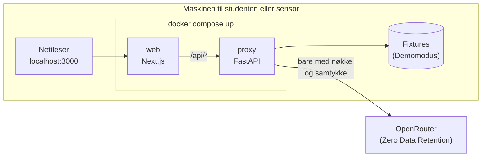
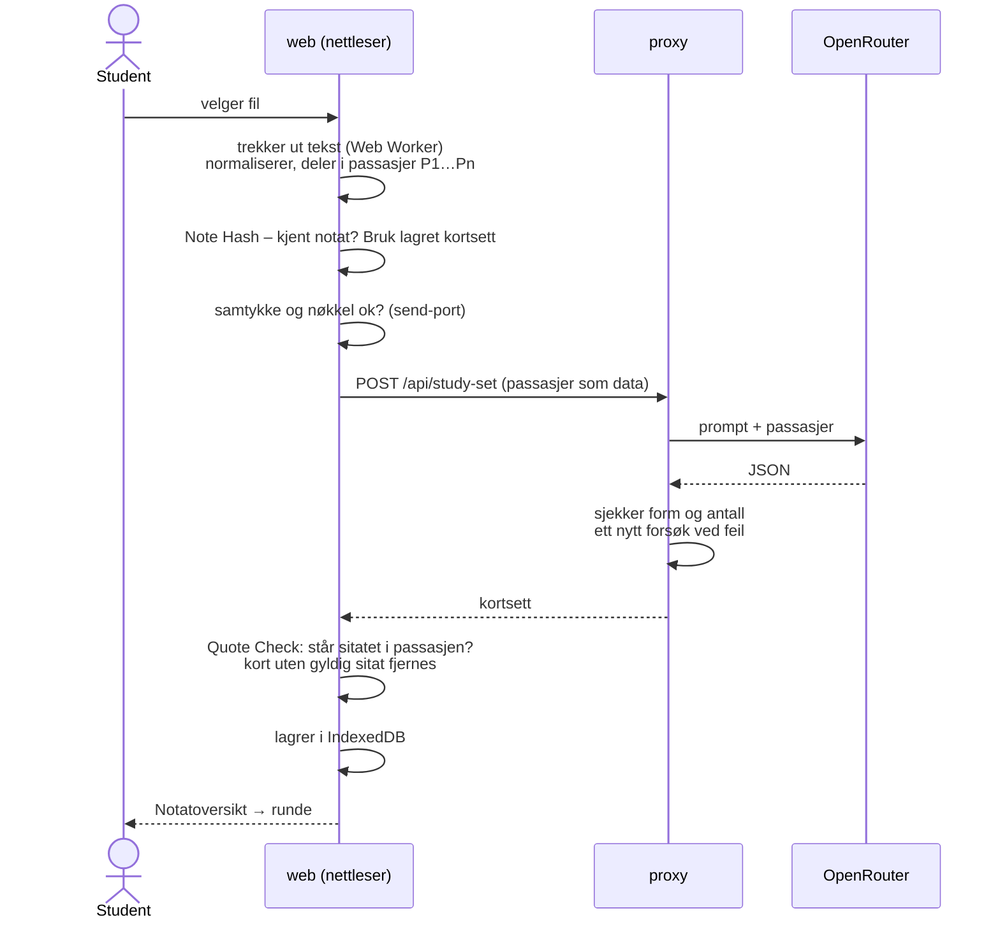
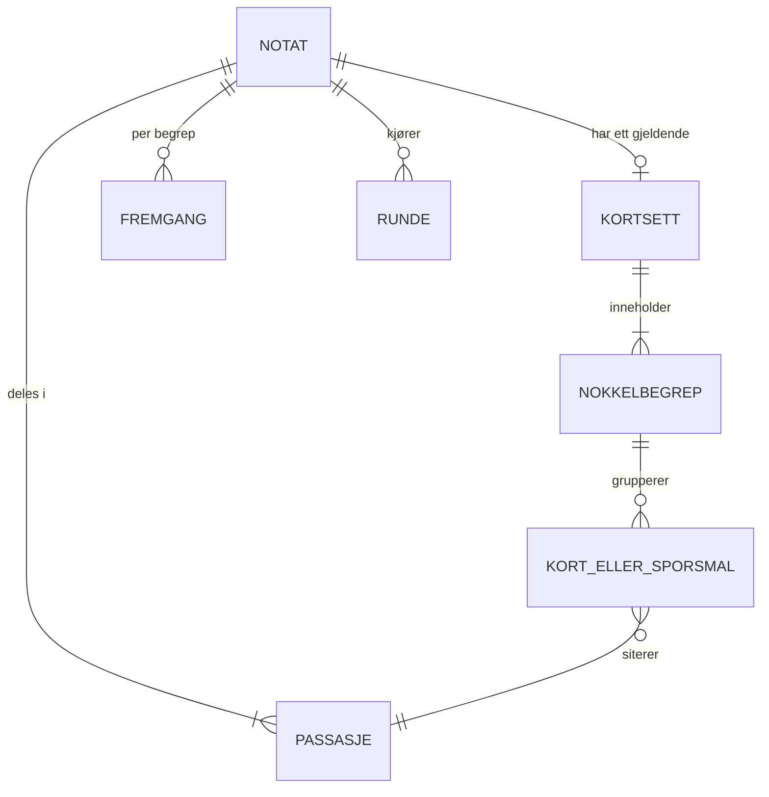

# Arkitekturen i Torsas læringsassistent – en lesevennlig oversikt

For sensor og faglærer. Dette er en forklaring av
[arkitekturdokumentet](architecture-G75-andersen-drage-2026-11-18/ARCHITECTURE-SPINE.md) («spine»), som er bindende for
implementeringen og har 21 arkitekturbeslutninger (AD-1 til AD-21). Her står *hva* som er bestemt og *hvorfor*; detaljene står
i spine-dokumentet. Teknologivalg, versjoner og miljøvariabler står i [technology-G75.md](technology-G75.md).

**Status 2026-11-22:** arkitekturen er ferdig (`status: final`). Story 1.1 er bygget; resten bygges story for story etter
[epics.md](../epics.md).

---

## 1. Problemet arkitekturen løser

Appen gjør et fagnotat om til nøkkelbegreper, flashcards og quiz. Den vanlige svakheten ved slike verktøy er at KI-en
**finner på ting**. Kjerneløftet i PRD-en er derfor: *hvert kort og spørsmål viser et sitat fra notatet ditt, og koden har
sjekket at sitatet står der* (FR-9, FR-12).

Det gir arkitekturen tre krav som styrer nesten alt annet:

1. **Samme tekst overalt.** Modellen, kildepanelet og sitatsjekken må se nøyaktig samme tekst, ellers feiler gyldige sitater
   eller markeringen havner feil sted.
2. **Notatet er privat.** Det sendes bare etter samtykke, bare til en leverandør som ikke lagrer det, og det havner aldri i logger.
3. **Sensor skal kunne kjøre alt** med én kommando og uten API-nøkkel.

---

## 2. Det store bildet

- **`web`** er hele appen: skjermene, tekstuttrekket, sitatsjekken, mestringsberegningen og lagringen. Alt studenten lagrer,
  ligger i **nettleseren** (IndexedDB). Det finnes ingen server-database.
- **`proxy`** er en tynn port mot KI-leverandøren. Den holder API-nøkkelen og promptene, kaller modellen og sjekker at svaret
  har riktig form. Den **lagrer ingenting** og skriver ingen filer.
- **Demomodus:** uten nøkkel svarer proxyen med ferdig innspilte svar (Fixtures) for eksempelnotatene – gjennom nøyaktig samme
  kode som et live-svar. Sensor kan dermed prøve hele løkka uten nøkkel (AD-12).

**Hvorfor to tjenester og ikke bare Next.js?** Nøkkelen må ligge på en server og ikke i nettleseren, og oppsettet følger
referanseoppsettet fra faglærer (FastAPI + pydantic-ai + OpenRouter). Alt annet fra Pytagoras-oppsettet – database, cache, innlogging,
betaling, hosting – er utelatt fordi appen er lokal og ikke har noe å lagre på serversiden (AD-1).

---

## 3. Hva skjer når studenten laster opp et notat

Tre ting er verdt å merke seg:

- **Teksten behandles bare ett sted** – i nettleseren (`web/core/`). Proxyen normaliserer eller sammenligner aldri notattekst.
  Da finnes det bare én implementasjon som kan ta feil, og passasjene som vises i kildepanelet er de samme objektene som ble
  sendt og sjekket (AD-3, AD-8).
- **Sitatsjekken skjer etter at proxyen har svart**, i nettleseren. Et kort med et sitat som ikke finnes i notatet, vises aldri
  (AD-19).
- **Bare proxyen prøver på nytt, og bare én gang.** Nettleseren venter i høyst 90 sekunder og viser så en feilmelding med
  «Prøv igjen» (AD-7).

---

## 4. De viktigste beslutningene, forklart

| # | Beslutning | Hvorfor |
| --- | --- | --- |
| AD-2 | `docker compose up` starter alt; sensor trenger bare Docker | Ingen Node- eller Python-versjoner å installere, samme oppførsel på alle maskiner |
| AD-3 | All logikk på notattekst ligger i nettleseren; proxyen eier bare prompt, KI-kall og formsjekk | To implementasjoner av normalisering ville stille vært uenige og fjernet gyldige kort |
| AD-4 | API-kontrakten defineres én gang, i Python (Pydantic); TypeScript-typene genereres fra den | Python og TypeScript kan ikke drive fra hverandre – CI feiler hvis de gjør det |
| AD-6 | Bare tre endepunkter; alle feil er en tekstnøkkel | Studenten ser aldri rå feiltekst, og alle feilmeldinger står på norsk ett sted |
| AD-8 | Én tekstpipeline for alle filformater | Modell, kildepanel og sitatsjekk ser samme tekst |
| AD-10, AD-21 | Én lagringsmodul, faste postformer, alt validert ved lesing | Senere stories kan ikke finne på sine egne lagringsformer; ødelagte data nullstilles per notat i stedet for å krasje appen |
| AD-11 | Skjermene endrer aldri tilstand selv; de kaller rene funksjoner i `core/` | Mestring og runder kan testes uten nettleser, og et sent svar skrives aldri inn i feil notat |
| AD-12 | Demomodus bruker samme endepunkter og samme validering som live | En demo som virker mens live-veien er ødelagt, ville vært verdiløs som test |
| AD-13 | OpenRouter med Zero Data Retention; notatteksten sendes som data, aldri som instruksjoner | Notatet skal ikke lagres eller trenes på hos leverandøren, og en tekst i notatet skal ikke kunne styre modellen |
| AD-14 | Proxyen lagrer og logger ingen notattekst eller nøkkel | Personvern; en automatisk test sjekker at en markørstreng ikke havner i logg eller fil |
| AD-15, AD-16 | Designtokens fra DESIGN.md, Radix for dialog/meny/faner, all UI-tekst i én fil | Lik stil på tvers av skjermer, tastaturstøtte etter WCAG, ingen tekst spredt i komponentene |
| AD-17 | Should-funksjoner bak flagg i `features.ts` | Funksjoner som ikke blir ferdige innen kuttdatoen 6. desember, skjules uten døde knapper |
| AD-18 | Én testkommando, lik lokalt og i CI, uten nøkkel | Det som er grønt lokalt, er grønt i CI |
| AD-20 | Én «send-port» avgjør om noe kan sendes: Demo → samtykke → nøkkel | Samme regel overalt – opplasting, «Prøv igjen» og «Forklar enklere» |

---

## 5. Hvor dataene ligger

- **IndexedDB** (i nettleseren): notater med passasjer, verifiserte kortsett, fremgang per begrep og runder.
- **localStorage**: innstillinger og samtykke.
- **Ingenting på serversiden.** Sletter nettleseren dataene sine, er fremgangen borte. README og appen sier dette, og eksport
  av fremgang er en Should-funksjon (FR-22).
- Et notat identifiseres med en **Note Hash** (SHA-256 av den normaliserte teksten). Laster studenten opp samme notat igjen,
  brukes det lagrede kortsettet uten nytt KI-kall (FR-4).

---

## 6. Personvern og sikkerhet

| Risiko | Tiltak |
| --- | --- |
| Notatet havner hos en leverandør som lagrer det | Samtykke før første sending; OpenRouter med `zdr: true, data_collection: "deny"` (AD-13) |
| Nøkkelen lekker | Finnes bare i proxyens miljø (`.env`, git-ignorert); nettleseren har ingen hemmeligheter (AD-14) |
| Notattekst i logger | Proxyen logger bare metode, sti, status, varighet og feilkode; test med markørstreng (AD-14) |
| Instruksjoner i notatet styrer modellen | Teksten sendes som JSON-data under en fast avgrensning; testnotat med injeksjonsforsøk i `reference-notes/edge-cases/` |
| Andre nettsider kaller proxyen | Bare `127.0.0.1` publiseres; `POST` krever riktig `Origin`; rate limit 10 live-kall per minutt (AD-5) |
| Uventede kostnader | Nøkkelen opprettes med kredittgrense hos OpenRouter; omtrent USD 0,002–0,006 per notat (AD-13) |

---

## 7. Hvordan arkitekturen testes

`docker compose run --rm test` kjører alt, uten nøkkel, og GitHub Actions kjører samme kommando (AD-18):

- **Vitest** – ren logikk i `core/` og tekstuttrekket, inkludert referansenotatene og kanttilfellene.
- **pytest** – proxyen med modellen stubbet: tidsbudsjett, oppstart uten nøkkel, opphav og rate limit, validering av Fixtures,
  logghygiene.
- **Playwright med axe** – hele Demo-løkka i nettleseren, dobbeltklikk, «Prøv igjen» og omlasting midt i genereringen, og
  tilgjengelighetssjekk på hovedskjermene (ingen alvorlige eller kritiske funn).
- **Kontrakt-diff** – CI genererer TypeScript-typene på nytt og feiler hvis de avviker fra Python-kontrakten.

---

## 8. Hva som bevisst er utelatt

| Utelatt | Hvorfor |
| --- | --- |
| Hosting, database, backup, overvåkning | Lokal app uten data på serversiden (PRD §7) |
| Brukerkontoer og innlogging | Én bruker per nettleser |
| Word-ligninger (OMML) i `.docx` | Kjent begrensning i v1, står i README (AD-8) |
| Endelig modell og tidsgrenser | Velges ved en modellsammenligning på referansenotatene; bare `.env` endres (AD-13) |
| Promptformulering | Eies av `proxy/app/prompts/` og versjoneres med `PROMPT_VERSION` |

---

## 9. Sporbarhet

Hver AD i spine-dokumentet viser hvilke krav (FR, NFR, DR) den binder, og hver story i [epics.md](../epics.md) viser til
sine FR- og AD-ID-er. Avvik fra planen føres i [`.docs/deviations.md`](../../deviations.md).
